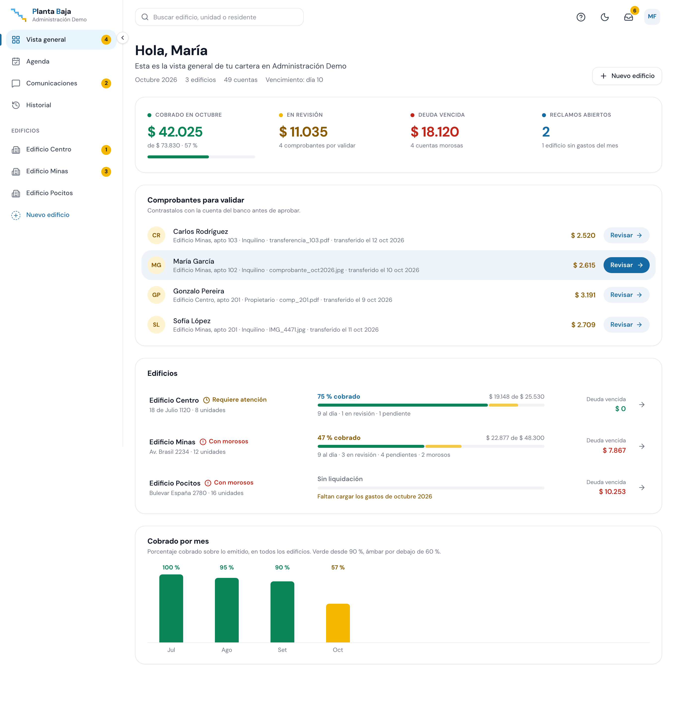
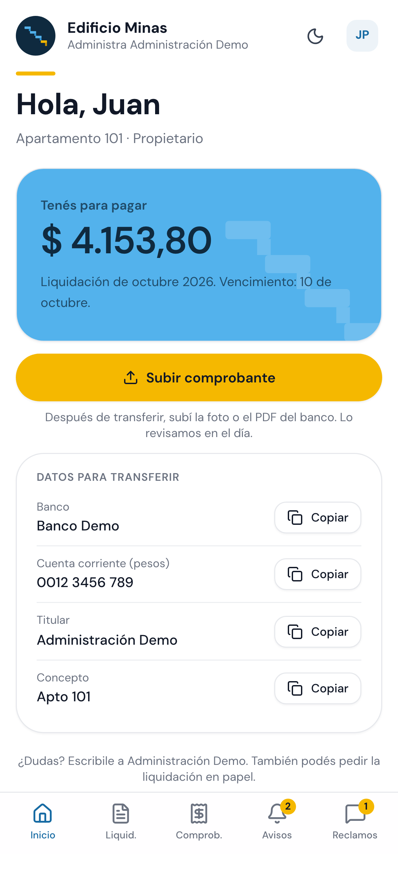
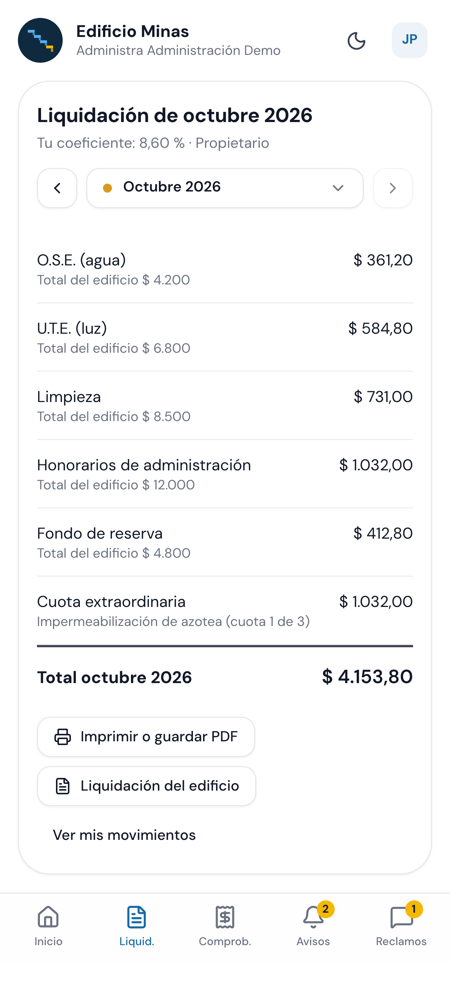

# Planta Baja

**SaaS de gestión para edificios de propiedad horizontal.** Digitaliza el trabajo de administradoras que hoy operan con Excel y papel: expensas, liquidaciones, cobranza y comunicación con los residentes, en un solo lugar.

> Proyecto real en desarrollo (MVP). Caso de uso inicial: **Confort S.A.**, Montevideo, Uruguay.
> _(Nombre interno del repo: `administracion-gc`.)_

## Qué hace

- **Expensas:** carga mensual de gastos del edificio (OSE, UTE, limpieza, honorarios, fondo de reserva).
- **Liquidación:** prorrateo automático por coeficiente de copropiedad y liquidación individual por apartamento en PDF.
- **Cobranza:** el residente sube el comprobante → la administración lo valida contra el banco → se imputa en la cuenta corriente.
- **Portal del residente:** cuenta corriente, liquidaciones, comprobantes, avisos y reclamos.
- **Panel de administración:** cartera de morosos, validación de pagos, avisos y comunicación bidireccional.
- **Contingencia analógica:** exportación a PDF y Excel siempre disponible (requisito del cliente).

## Capturas

**Panel de administración** — cartera del edificio de un vistazo:



**Portal del residente** (móvil) — cuenta corriente y liquidación del mes:

<p>
  
  &nbsp;&nbsp;
  
</p>

## Stack

| Capa | Tecnología |
|---|---|
| **Backend** | Python 3.12 · Django 5 · Django REST Framework |
| **Base de datos** | PostgreSQL 16 |
| **Tareas async** | Celery · Redis (PDFs, emails) |
| **Almacenamiento** | Cloudflare R2 (MinIO en desarrollo), con URLs firmadas |
| **Frontend** | React 19 · TypeScript · Vite · Tailwind v4 · shadcn/ui |
| **Infra** | Docker Compose (desarrollo) · Railway (producción) |

## Decisiones de diseño

El proyecto documenta sus decisiones como **ADRs** en [`docs/adr/`](docs/adr/). Algunas que marcan el carácter del sistema:

- **[Libro mayor append-only](docs/adr/0007-libro-mayor-append-only.md):** los movimientos financieros son inmutables — nunca se hace UPDATE/DELETE. Cada corrección es un asiento nuevo.
- **[Multi-tenant por organización](docs/adr/0003-multi-tenant-por-organizacion.md):** aislamiento estricto por edificio; un usuario nunca ve datos de otro. PKs **UUID** para evitar enumeración de recursos.
- **[El pago es una verificación humana](docs/adr/0008-pago-es-verificacion-humana.md):** no hay auto-validación; la administración concilia cada comprobante contra el banco.
- **[Dinero en `Decimal` + redondeo explícito](docs/adr/0011-dinero-decimal-y-redondeo.md):** nada de floats para plata; el prorrateo se calcula en el backend.
- **[Archivos en R2 con URLs firmadas](docs/adr/0012-archivos-en-r2-con-urls-firmadas.md):** los archivos no pasan por el servidor de aplicación.
- **[Auditoría append-only](docs/adr/0013-auditoria-append-only.md):** toda acción sensible queda registrada.

Vista general de la arquitectura, UML y diagramas de secuencia en [`docs/arquitectura/`](docs/arquitectura/).

## Estructura

```
.
├── backend/          # Django — API REST y lógica de negocio
│   └── apps/
│       ├── accounts/       # usuarios, organizaciones, membresías, invitaciones
│       ├── buildings/      # edificios y unidades
│       ├── people/         # residentes (propietarios / inquilinos)
│       ├── ledger/         # libro mayor append-only, cuentas corrientes
│       ├── settlements/    # liquidaciones y prorrateo
│       ├── storage/        # comprobantes y archivos (R2 / MinIO)
│       ├── documents/      # PDF y Excel
│       ├── communications/ # avisos y reclamos
│       ├── audit/          # registro de auditoría
│       └── core/           # UUIDs, timestamps, base común
├── frontend/         # App React (panel, portal y accesos) — Vite + Tailwind + shadcn/ui
├── landing/          # Landing pública (estática)
├── docs/             # ADRs, arquitectura, modelo de datos, auditorías
└── docker-compose.yml
```

## Correr en local

Requisitos: Docker (Docker Desktop, u OrbStack/Colima en macOS) y Node 22.

```bash
cp backend/.env.example backend/.env   # completar SECRET_KEY y MINIO_ROOT_* (ver docs/docker.md)
make front-install && make front-build # compila el front (React) que sirve Django
make up                                # levanta web, Postgres, Redis, MinIO y Mailpit
make migrate
make seed DEMO_PASSWORD=una_clave_de_al_menos_10_caracteres
make test
```

El servidor queda en `http://localhost:8000` (panel en `/panel`, portal en `/portal`, Django admin en `/admin`).
Detalle de servicios, puertos y trabajo desde varias máquinas: [`docs/docker.md`](docs/docker.md).

### Front con recarga en vivo

```bash
make front-dev   # http://localhost:5173 (proxyea /api a Django en :8000)
```

## Contexto del cliente

**Confort S.A.** — administradora de un edificio de 12 apartamentos en Montevideo, Uruguay. Opera con **Scotiabank** para el cobro de expensas. Marco legal: **Ley 10.751** de Propiedad Horizontal y **Ley 18.331** de protección de datos (Uruguay). Moneda: **UYU**.

## Licencia

Material propietario, publicado solo con fines de evaluación. Ver [`LICENSE`](LICENSE).
