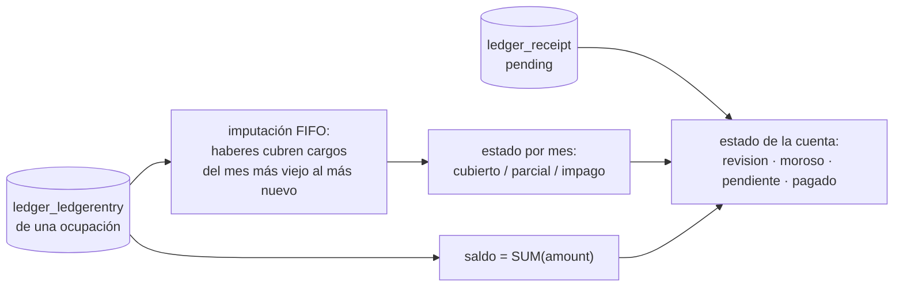

# Cómo se guarda la información

## 1. Dónde vive cada dato

| Dato | Dónde | Formato | Quién lo escribe |
|---|---|---|---|
| Organizaciones, edificios, unidades, personas, ocupaciones | PostgreSQL | tablas normalizadas, PK UUID | servicios del panel |
| Liquidaciones y sus ítems | PostgreSQL | `settlement` + `settlementitem` | `SettlementService` |
| **Libro mayor** (cargos, pagos, ajustes) | PostgreSQL | `ledgerentry`, **append-only** | solo servicios; nunca a mano |
| Saldo y estado de cada cuenta | **no se guardan**: se calculan | `SUM(amount)` + imputación FIFO | `AccountService` |
| Comprobantes (archivo) | Cloudflare R2, bucket privado | objeto `receipts/<org>/<uuid>` | el navegador, con URL firmada |
| Comprobantes (metadatos) | PostgreSQL | `receipt` + `receiptallocation` | `PaymentService` |
| PDFs de liquidación | R2 | `settlements/<org>/<building>/<YYYY-MM>/<uuid>.pdf` | worker Celery |
| Usuarios y contraseñas | PostgreSQL | `accounts_user`, hash **Argon2** | Django auth |
| Sesiones | PostgreSQL | `django_session` (solo el id viaja en la cookie) | Django |
| Intentos de login | PostgreSQL | tablas de `django-axes` | axes |
| Invitaciones | PostgreSQL | solo el **sha256 del token** | `InvitationService` |
| Auditoría | PostgreSQL | `auditlog`, **append-only** | `AuditService` |
| Cola de tareas | Redis | mensajes de Celery (solo IDs, nunca datos personales) | `web` |
| Secretos (claves, credenciales) | variables de entorno de Railway / `.env` local | — | nunca en el repo |

## 2. Esquema en PostgreSQL

Los nombres de tabla son los que genera Django (`<app>_<modelo>`). Todas las PK son `uuid`. Los montos son `numeric(12,2)` y los coeficientes `numeric(7,6)`; nunca `float`.

### Identidad y tenancy

| Tabla | Columnas clave | Restricciones e índices |
|---|---|---|
| `accounts_user` | `email`, `password`, `is_active`, `is_staff` | `UNIQUE (lower(email))` |
| `accounts_organization` | `name`, `tax_id`, `email` | — |
| `accounts_orgmembership` | `user_id`, `organization_id` | `UNIQUE (user_id, organization_id)` |
| `accounts_invitation` | `person_id`, `email`, `token_hash`, `expires_at`, `used_at`, `revoked_at` | `UNIQUE (token_hash)`; índice en `person_id` |

### Edificios y personas

| Tabla | Columnas clave | Restricciones e índices |
|---|---|---|
| `buildings_building` | `organization_id`, datos bancarios, `due_day`, `reserve_opening`, `opening_date` | `CHECK (due_day BETWEEN 1 AND 28)`; índice en `organization_id` |
| `buildings_unit` | `building_id`, `number`, `floor`, `coefficient` | `UNIQUE (building_id, number)`; `CHECK (coefficient > 0 AND coefficient <= 1)` |
| `buildings_expenseconcept` | `building_id`, `name`, `kind`, `is_reserve_fund` | `UNIQUE (building_id, name)`; `UNIQUE (building_id) WHERE is_reserve_fund` (índice parcial) |
| `people_person` | `organization_id`, nombre, `document`, `phone`, `email`, `user_id` | `UNIQUE (organization_id, lower(email)) WHERE email <> ''` |
| `people_occupancy` | `unit_id`, `person_id`, `role`, `start_date`, `end_date` | `CHECK (end_date IS NULL OR end_date >= start_date)`; **`EXCLUDE USING gist (unit_id WITH =, role WITH =, daterange(start_date, end_date, '[]') WITH &&)`** |

La restricción `EXCLUDE` es la que garantiza en la base que nunca haya dos inquilinos (o dos propietarios) de la misma unidad en los mismos días. Necesita la extensión `btree_gist`, que se activa en la primera migración (B0).

### Dinero

| Tabla | Columnas clave | Restricciones e índices |
|---|---|---|
| `settlements_settlement` | `building_id`, `month`, `status`, `issued_at`, `issued_by_id` | `UNIQUE (building_id, month)`; `CHECK (EXTRACT(day FROM month) = 1)` |
| `settlements_settlementitem` | `settlement_id`, `concept_id`, `amount`, `detail` | `UNIQUE (settlement_id, concept_id)`; `CHECK (amount >= 0)` |
| `ledger_ledgerentry` | `occupancy_id`, `date`, `kind`, `amount`, `settlement_id`, `concept_id`, `receipt_id`, `adjusts_id`, `created_by_id`, foto del cálculo | índice `(occupancy_id, date)`; `CHECK (kind <> 'payment' OR amount < 0)`; `CHECK (kind <> 'charge' OR amount >= 0)`; **trigger append-only** |
| `ledger_receipt` | `person_id`, `file_key`, `file_sha256`, `declared_amount`, `status`, revisión | `UNIQUE (file_key)`; `CHECK (declared_amount > 0)`; índice `(status)` para la cola de pendientes |
| `ledger_receiptallocation` | `receipt_id`, `occupancy_id`, `amount` | `UNIQUE (receipt_id, occupancy_id)`; `CHECK (amount > 0)` |

**Trigger append-only** (se crea en una migración con `RunSQL`, en B4):

```sql
CREATE FUNCTION ledger_append_only() RETURNS trigger AS $$
BEGIN
  RAISE EXCEPTION 'ledger_ledgerentry es append-only: registrá un asiento de ajuste';
END;
$$ LANGUAGE plpgsql;

CREATE TRIGGER ledgerentry_no_update_delete
  BEFORE UPDATE OR DELETE ON ledger_ledgerentry
  FOR EACH ROW EXECUTE FUNCTION ledger_append_only();

-- TRUNCATE no dispara triggers por fila; se bloquea aparte.
CREATE TRIGGER ledgerentry_no_truncate
  BEFORE TRUNCATE ON ledger_ledgerentry
  FOR EACH STATEMENT EXECUTE FUNCTION ledger_append_only();
```

Lo mismo se aplica a `audit_auditlog` y a `communications_claimmessage`. Como el trigger también bloquea los `DELETE` en cascada, todas las FK hacia estas tablas son `on_delete=PROTECT`: las entidades con historia **se desactivan, no se borran**.

### Comunicación, tareas y auditoría

| Tabla | Columnas clave | Restricciones e índices |
|---|---|---|
| `communications_notice` | `building_id`, `title`, `body`, `published_by_id` | índice `(building_id, created_at)` |
| `communications_claim` | `building_id`, `unit_id`, `author_id`, `kind`, `status` | índice `(building_id, status)` |
| `communications_claimmessage` | `claim_id`, `author_id`, `from_admin`, `text` | append-only |
| `communications_task` | `organization_id`, `building_id`, `text`, `due_date`, `done` | índice `(organization_id, done)` |
| `audit_auditlog` | `actor_id`, `organization_id`, `action`, `target_type`, `target_id`, `data`, `ip` | append-only; índices `(organization_id, created_at)` y `(target_type, target_id)` |

## 3. Cómo se calcula lo que no se guarda



- El saldo nunca se guarda en una columna: no puede quedar desincronizado con los asientos.
- Para la cartera (muchas cuentas a la vez), se resuelve con una consulta agregada por ocupación (`GROUP BY occupancy_id`). Si en el futuro hiciera falta velocidad, se agrega una vista materializada que se refresca al escribir, nunca una columna editable.

## 4. Archivos en R2

| Aspecto | Regla |
|---|---|
| Visibilidad | Bucket **privado**. Sin URLs públicas. |
| Nombre | `file_key` aleatorio (UUID); el nombre original no se usa en la ruta. |
| Subida | URL firmada `PUT` de 5 minutos, con `Content-Type` y tamaño fijados en la firma. |
| Verificación | Al registrar el comprobante, el backend lee los primeros bytes (magic bytes), el tamaño y calcula el sha256. Si no coincide con lo declarado, se rechaza y se borra el objeto. |
| Descarga | URL firmada `GET` de 5 minutos, generada solo si el usuario tiene acceso al comprobante. |
| Tipos permitidos | JPEG, PNG, HEIC, WebP y PDF; máximo 10 MB. |
| Objetos huérfanos | Una tarea periódica borra los objetos subidos que no quedaron asociados a un `Receipt` después de 24 h. |

## 5. Datos personales y retención

| Dato | Sensibilidad | Tratamiento |
|---|---|---|
| Email, teléfono, CI | Personal | Solo lo ve la administración de esa organización y la propia persona. No se escribe en logs ni en `AuditLog.data`. |
| Comprobantes bancarios | Personal y financiero | R2 privado y URLs firmadas cortas. Se conservan como evidencia aunque se rechacen. |
| Libro mayor y auditoría | Financiero | No se borran nunca (append-only). |
| Contraseñas | Secreto | Solo el hash Argon2. |
| Tokens de invitación | Secreto | Solo el sha256; el token en claro existe únicamente en el email. |

Marco legal a tener en cuenta: **Ley 18.331 de Protección de Datos Personales (Uruguay)**. Antes de operar con clientes reales hay que definir con un abogado la retención de los comprobantes y el procedimiento ante un pedido de baja: el libro mayor no se puede borrar, así que una baja se resuelve anonimizando a la `Person`, no eliminando sus asientos.

## 6. Respaldo y recuperación

- PostgreSQL administrado en Railway con backups diarios; antes de producción se prueba **una restauración completa** en un entorno aparte (un backup que nunca se restauró no está probado).
- R2: versionado de objetos activado en el bucket de producción.
- La migración día cero se hace con un asiento `opening` por ocupación, con el saldo a la fecha de corte (`Building.opening_date`); el histórico de Excel no se migra ([ADR-0014](../adr/0014-migracion-dia-cero.md)).
