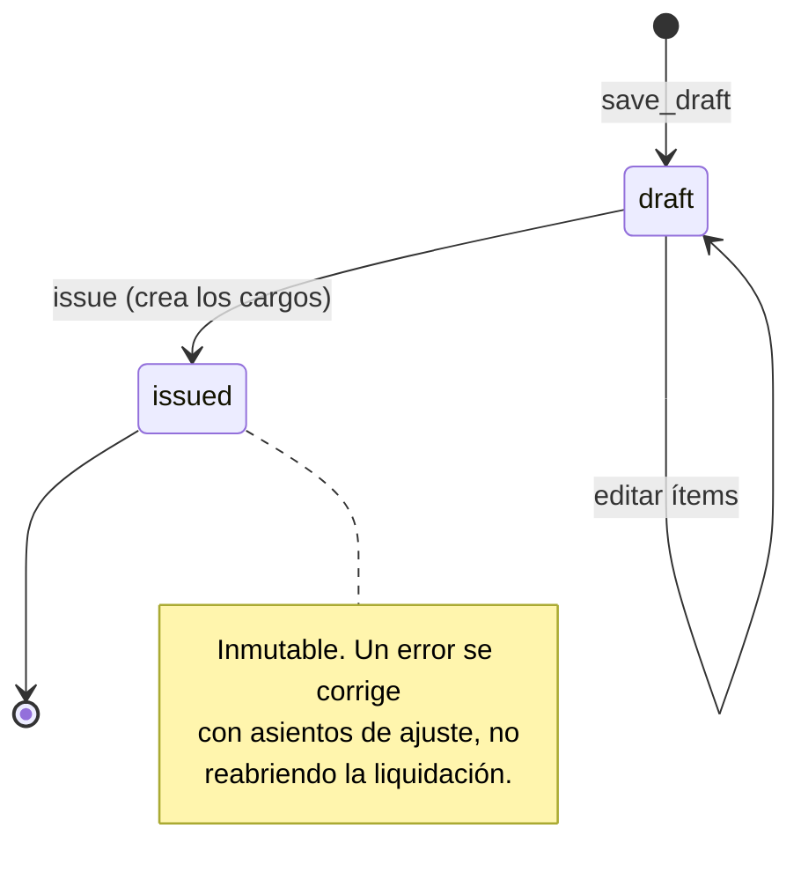
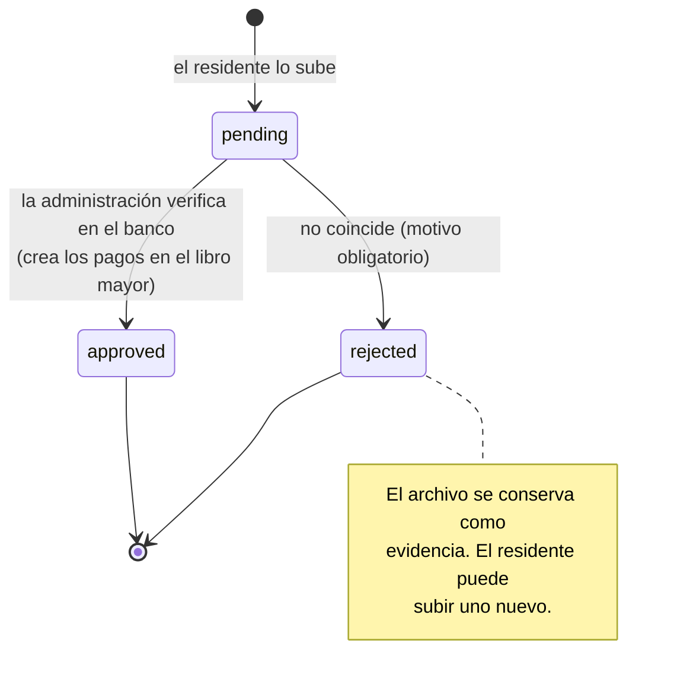
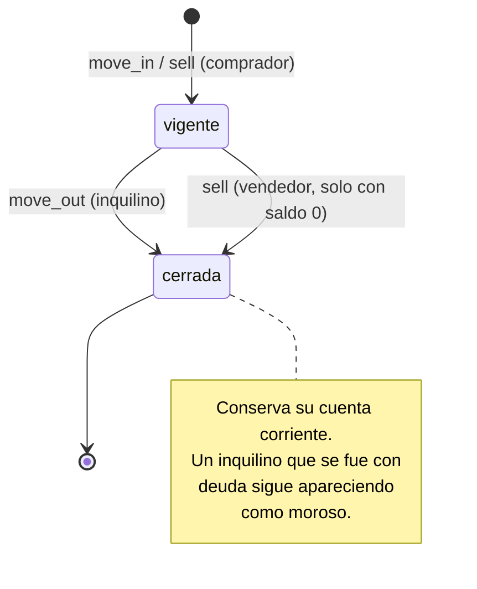
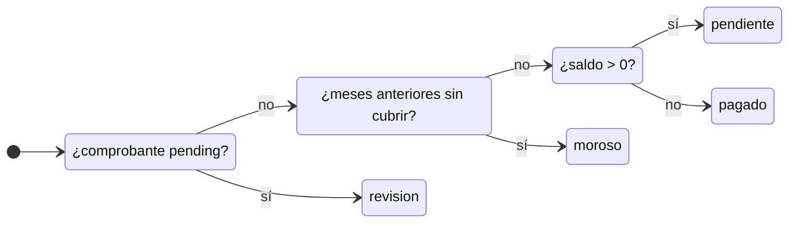
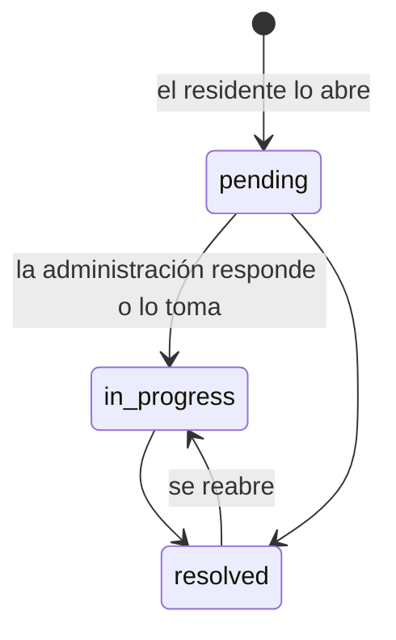
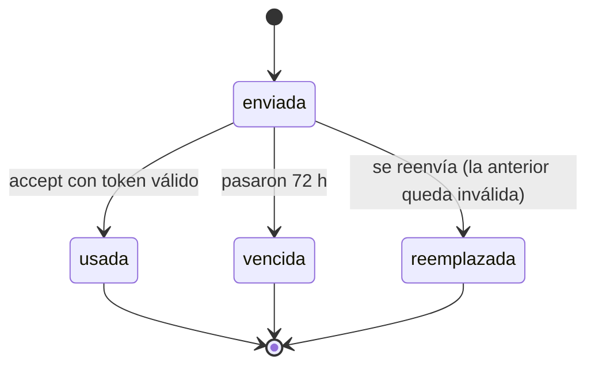

# UML — Diagramas de estados

## Liquidación (`Settlement`)

## Comprobante (`Receipt`)

## Ocupación (`Occupancy`)

## Estado de cuenta de una ocupación (calculado, no guardado)

Es el mismo criterio que usa el front (`design/assets/ledger.js`), con la imputación FIFO de pagos parciales del modelo nuevo.

## Reclamo (`Claim`)

## Invitación (`Invitation`)

