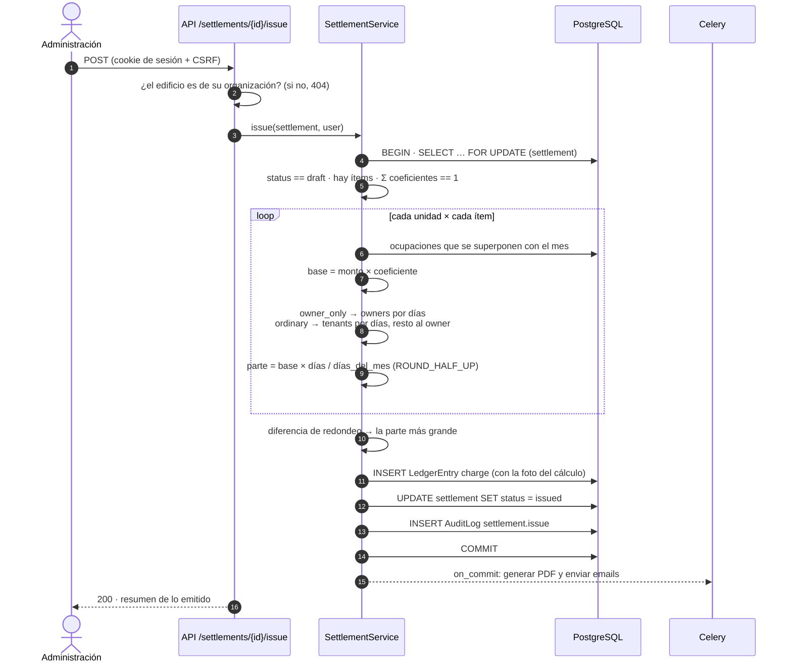
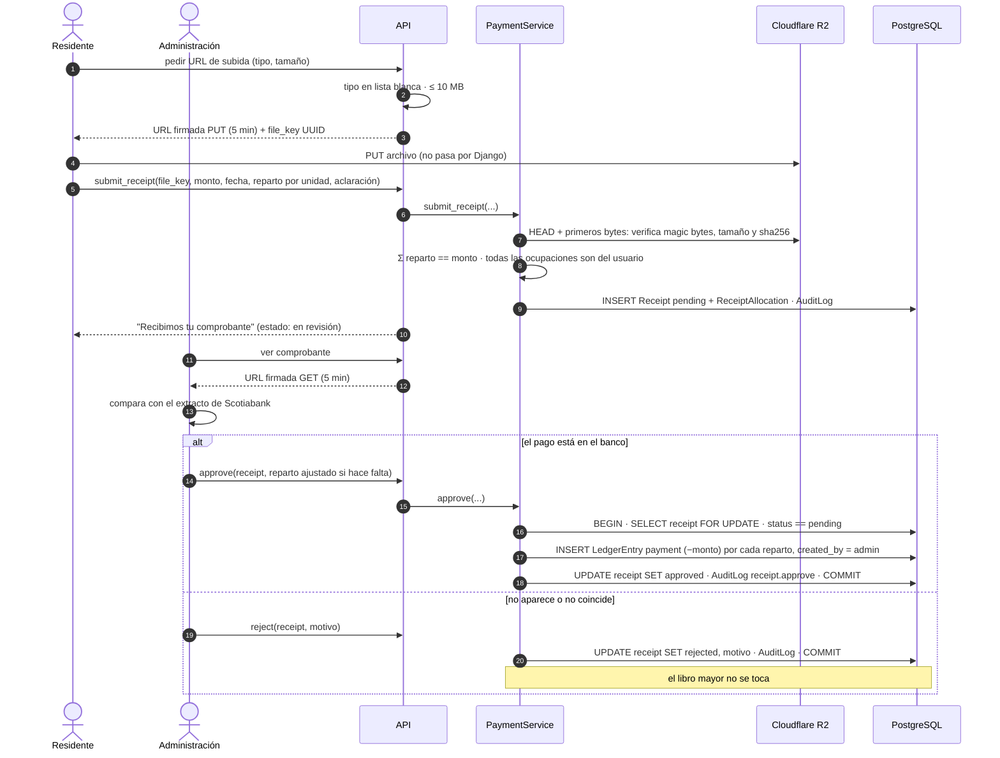
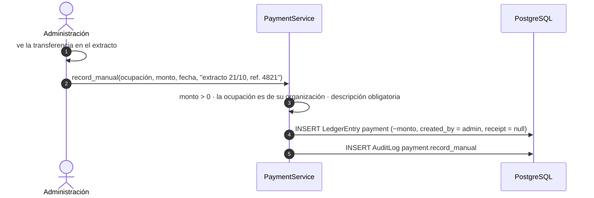
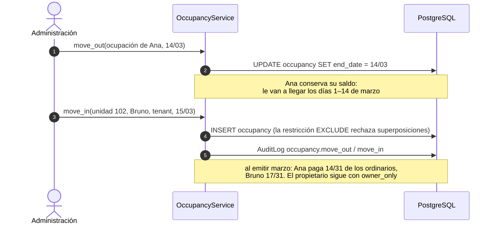
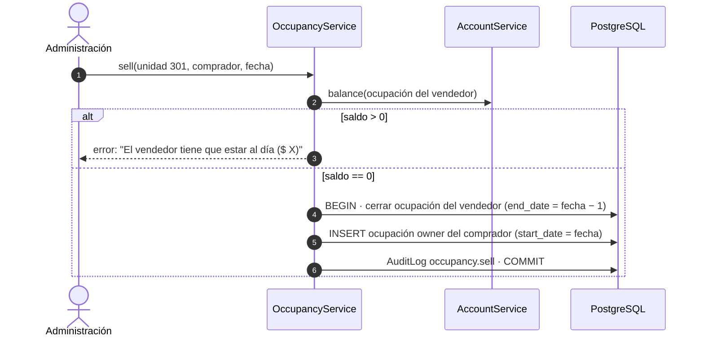
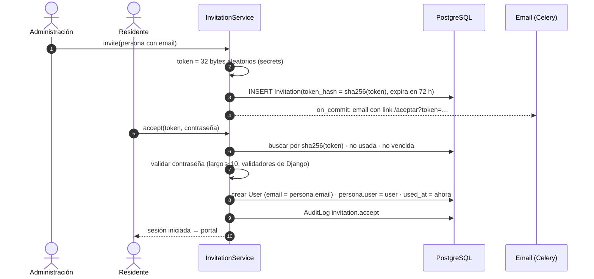
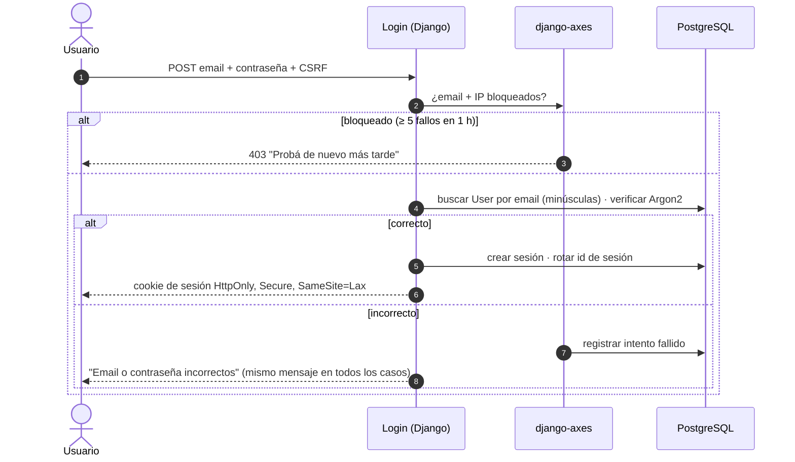

# UML — Diagramas de secuencia

Los flujos críticos del sistema. Cada servicio corre en una transacción; si algo falla, no queda nada a medias.

## 1. Emitir la liquidación del mes

## 2. Pago con comprobante (residente → verificación de la administración)

El `SELECT … FOR UPDATE` más el chequeo de `pending` hacen que aprobar dos veces (doble clic, dos admins a la vez) no duplique el pago.

## 3. Pago registrado sin comprobante

## 4. Mudanza de inquilino

## 5. Venta de la unidad

## 6. Invitación y primer ingreso del residente

El token en claro solo existe en el email; en la base queda su hash, así una filtración de la base no permite activar cuentas.

## 7. Login y protección contra fuerza bruta

