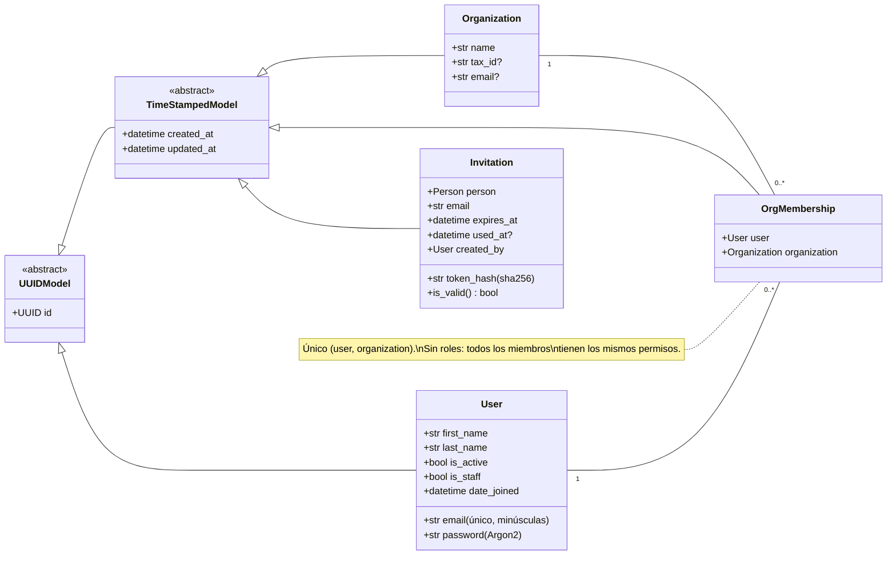
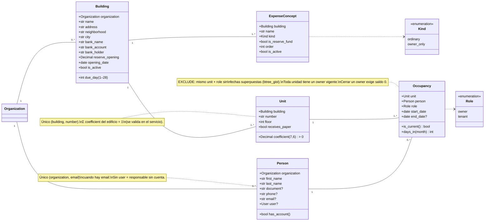
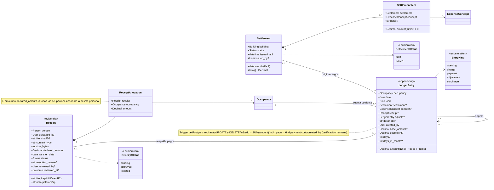
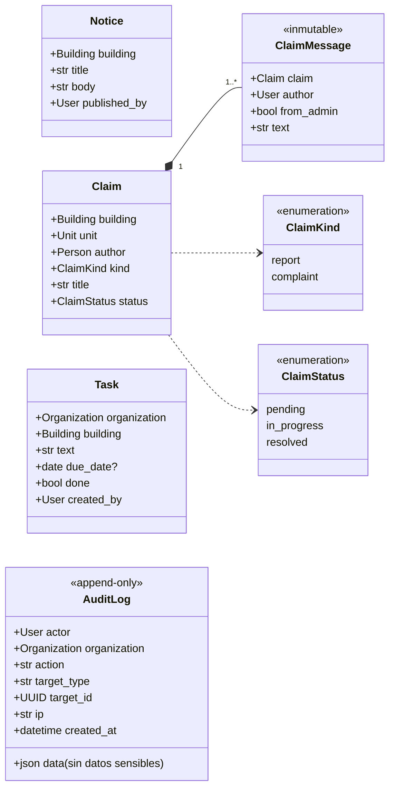
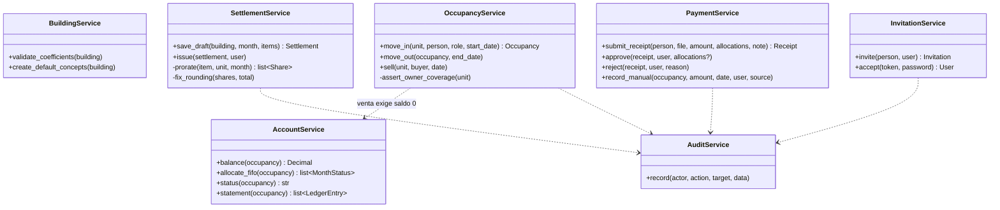

# UML — Diagrama de clases

Refleja `docs/modelo-datos.md` (aprobado 2026-10-23). Los nombres son los del código (en inglés). Todas las clases tienen `id` UUID como clave primaria; `?` = opcional.

## 1. Bases e identidad (`core`, `accounts`)

## 2. Edificios, personas y ocupaciones

## 3. Liquidaciones, libro mayor y pagos

## 4. Comunicación, tareas y auditoría

## 5. Servicios de dominio

Toda escritura de negocio pasa por un servicio: corre en `transaction.atomic()`, valida, escribe y audita.

Las reglas de cada servicio están en [`modelo-datos.md` §5](../modelo-datos.md) y los flujos en [`secuencias.md`](secuencias.md).
