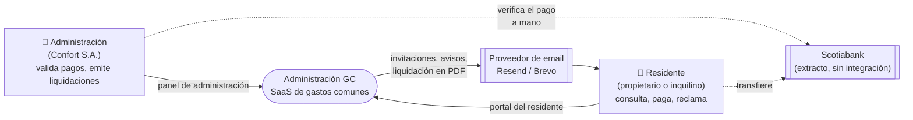
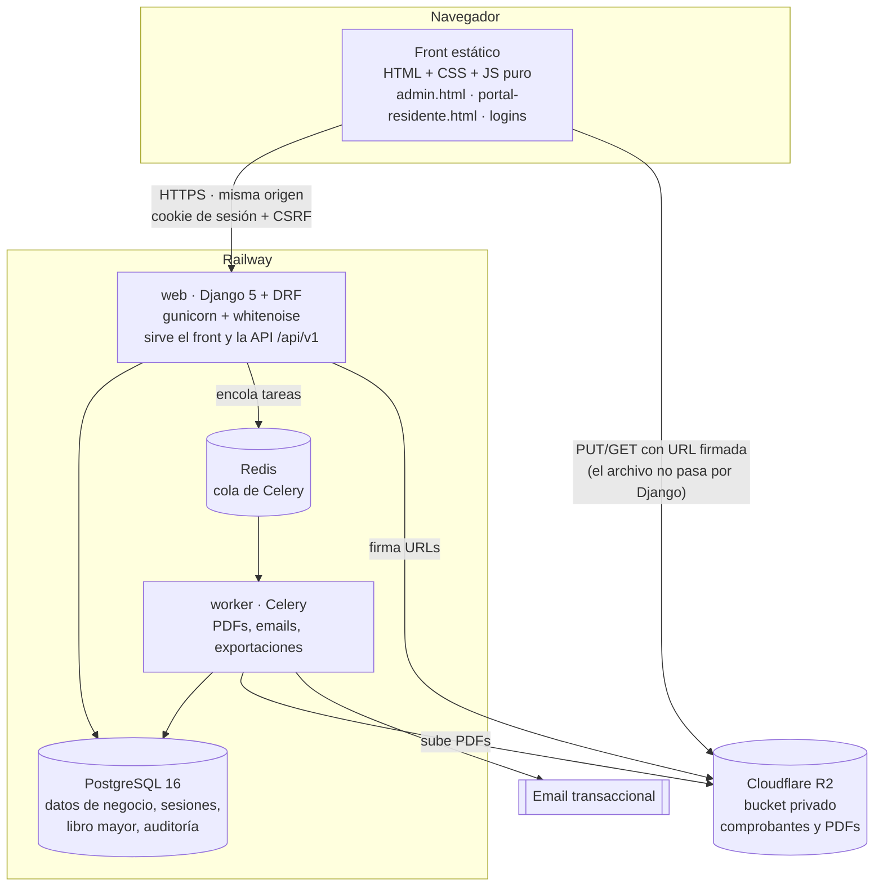
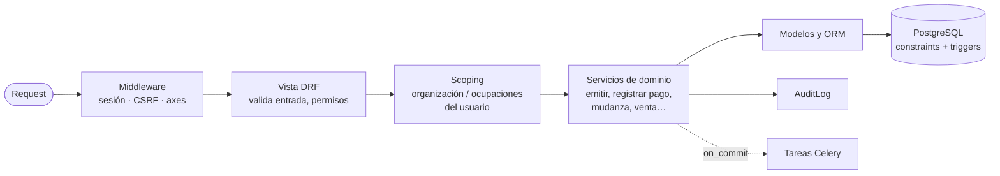
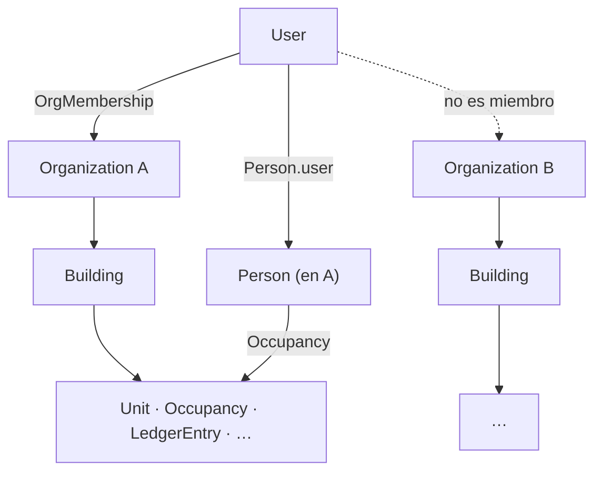

# Vista general de la arquitectura

Estado: 2026-10-23. Decisiones detalladas en [`../adr/`](../adr/README.md); modelo de datos en [`../modelo-datos.md`](../modelo-datos.md).

## 1. Contexto: quién usa el sistema

No hay integración con el banco: la administración confirma cada pago contra su extracto ([ADR-0008](../adr/0008-pago-es-verificacion-humana.md)).

## 2. Contenedores: qué corre y dónde

| Contenedor | Responsabilidad | No hace |
|---|---|---|
| Front estático | Pantallas del diseño final; arma el HTML en el navegador. | No calcula montos: los recibe de la API ([ADR-0011](../adr/0011-dinero-decimal-y-redondeo.md)). |
| `web` (Django) | Autenticación, permisos, reglas de negocio (servicios), API, firma de URLs. | No recibe archivos ([ADR-0012](../adr/0012-archivos-en-r2-con-urls-firmadas.md)). |
| `worker` (Celery) | Trabajo lento o masivo: PDF de liquidación, emails, Excel. | No decide reglas de negocio: llama a los mismos servicios. |
| PostgreSQL | Fuente de verdad de todo lo que no es un archivo. | — |
| R2 | Archivos: comprobantes y PDFs generados. | Nunca es público. |

## 3. Capas dentro de Django

- **Las vistas no tienen lógica de negocio**: validan, resuelven permisos y llaman a un servicio.
- **Los servicios** abren `transaction.atomic()`, toman locks (`select_for_update`) cuando cambian estado y escriben la auditoría en la misma transacción.
- **La base es la última barrera**: unicidades, la exclusión de ocupaciones superpuestas y el trigger append-only del libro mayor rechazan lo que se escape del código ([ADR-0007](../adr/0007-libro-mayor-append-only.md)).
- Las tareas Celery se encolan con `transaction.on_commit`, así nunca procesan datos de una transacción que después se deshizo.

## 4. Aislamiento multi-tenant

- **Panel:** toda consulta se restringe a los edificios de las organizaciones del usuario.
- **Portal:** toda consulta se restringe a las ocupaciones de las `Person` ligadas al usuario.
- Si el recurso pedido no está en el alcance del usuario, la respuesta es **404**, no 403, para no revelar que existe. Cada endpoint tiene su test ([ADR-0003](../adr/0003-multi-tenant-por-organizacion.md)).

## 5. Despliegue

| Entorno | Dónde | Notas |
|---|---|---|
| Desarrollo | `docker compose` (Postgres 16 + Django `runserver`) | Variables en `backend/.env` (ignorado por git); plantilla en `.env.example`. |
| Producción | Railway: servicios `web` y `worker`, Postgres y Redis administrados | TLS lo termina el proxy de Railway (`SECURE_PROXY_SSL_HEADER`); `check --deploy` sin warnings sin explicar. |
| Archivos | Cloudflare R2, un bucket por entorno | Credenciales solo en variables de entorno. |

Más sobre dónde vive cada dato: [`almacenamiento.md`](almacenamiento.md).
