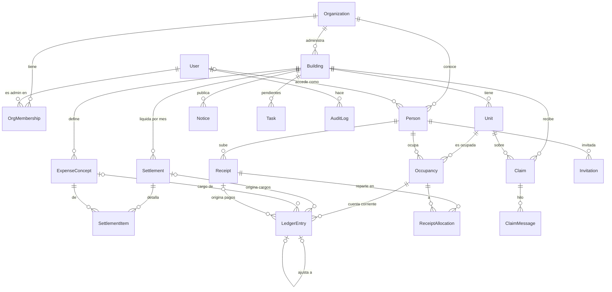

# Modelo de datos — backend v1

Estado: **aprobado por Nahuel** (2026-10-23). Diagramas UML, flujos, almacenamiento y ADR en [`docs/README.md`](README.md). Base de datos: **PostgreSQL 16** (`docker-compose.yml`, `postgres:16-alpine`). Reemplaza el esqueleto actual de `backend/apps/` (buildings, residents, expenses, ledger), que es anterior al diseño final y no cumple sus reglas.

Fuente de verdad funcional: el front final (`design/assets/ledger.js`, `data.js`) más las decisiones de negocio de esta página.

---

## 1. Decisiones de negocio (confirmadas por Nahuel)

| # | Tema | Decisión |
|---|---|---|
| N1 | Conceptos de gasto | **Configurables por edificio.** Cada concepto es *ordinario* (lo paga el inquilino si hay, si no el propietario) o *solo propietario* (fondo de reserva, extraordinarias, etc.). |
| N2 | Pagos | **Se aceptan pagos parciales.** Se imputan a la deuda más vieja primero (FIFO). Lo que sobra queda como saldo a favor. |
| N3 | Mora | **Sin recargo automático en el MVP.** El modelo admite asientos de tipo `recargo`, que la administración carga a mano. |
| N4 | Personas | **Una persona puede tener varias unidades**, incluso en edificios distintos. Un solo login. |
| N5 | Email | **Para tener usuario hace falta email.** Se entra con email y contraseña (se saca "o número de apartamento" del login). |
| N6 | Alta de residentes | **Por invitación de la administración:** link de un solo uso por email. No hay autorregistro. |
| N7 | Personas sin email | Pueden existir como responsables (nombre, teléfono, "recibe papel") con su cuenta corriente, **sin usuario**. |
| N8 | Usuarios de la administradora | Varios, **todos con los mismos permisos**. Cada acción queda auditada con quién la hizo. |
| N9 | Deuda y mudanzas | La deuda es de **la persona por el período que ocupó la unidad**, como establece el contrato de alquiler. Quien se va sigue debiendo su período; quien entra arranca en 0. Sin inquilino, el propietario asume todo. |
| N10 | Mitad de mes | **Prorrateo por días** entre quienes ocuparon la unidad ese mes. |
| N11 | Venta | **El vendedor tiene que estar al día** para cerrar su ocupación. El sistema lo bloquea si tiene saldo. |
| N14 | Control de empleados | **Tiene que quedar registrado en la base qué empleado edita qué**, con el valor anterior y el nuevo, para evitar desvíos. Vale para cualquier camino de edición: panel, admin de Django o acceso directo a la base. |
| N15 | Cuentas por empleado y log | **Cada empleado tiene su propia cuenta** ("María de Confort", "Pablo de Confort"), nunca compartida, para que el log de cambios diga quién hizo cada cosa. El log se **consulta cuando hace falta**; no se muestra en pantallas ni hay alertas ([ADR-0016](adr/0016-cuentas-nominativas-y-firma-visible.md)). |
| N16 | Gestión de ocupantes | **Un empleado de la administradora puede cambiar quién ocupa cada unidad**: alta y baja de inquilino, cambio de inquilino en una sola operación, venta, corrección de errores de carga y edición de los datos de las personas. Todo verifica que el empleado sea de esa organización y queda en el log. |
| N17 | Acceso del ex inquilino | **Conserva el acceso al portal hasta saldar su deuda**: ve solo su ocupación cerrada (saldo, movimientos, comprobantes) y puede subir comprobantes. Con saldo 0 deja de ver esa unidad. No ve avisos ni reclamos del edificio posteriores a su salida. Se aplica en los permisos del portal (C2). |
| N13 | Qué vale como pago | **Lo que cuenta es la verificación de una persona de la administración**, que confirma el pago contra el banco. El comprobante es solo respaldo: se guarda como prueba de que el pago existió, por si después hay un error o un reclamo. La administración también puede registrar un pago sin comprobante (por ejemplo, uno que vio directo en el extracto). |
| N12 | Un pago, varias unidades | Se acepta, **con aclaración**: al subir el comprobante, el residente indica cuánto va a cada unidad. La administración lo verifica y puede corregir el reparto al aprobar. |

## 2. Decisiones de diseño (mías; se pueden discutir)

| # | Decisión | Por qué |
|---|---|---|
| D1 | **La cuenta corriente es una `Occupancy`** (persona + unidad + rol + desde/hasta), no la unidad ni la persona. | Implementa N9 y N10 de forma directa: cada período tiene su propio saldo. |
| D2 | **El pago es el asiento `payment` que registra una persona de la administración** (`created_by` obligatorio): eso es lo que vale (N13). **El comprobante (`Receipt`) es evidencia aparte**: archivo, hash y quién lo subió, conservado como prueba. Un pago puede tener comprobante o no, y un comprobante rechazado nunca toca el libro mayor. | El esqueleto actual guarda `payment_status` en un movimiento "inmutable" y mezcla la prueba con la verificación. |
| D3 | **`LedgerEntry` es append-only en la base**: un trigger de Postgres rechaza `UPDATE` y `DELETE`, además de la validación en el modelo. Una corrección es un asiento `ajuste` que referencia al que corrige. | Hoy la inmutabilidad solo está en `save()`; un `QuerySet.update()` o el admin de Django la saltean. |
| D4 | **Un cargo por concepto**, con una foto del cálculo: total del concepto, coeficiente, días ocupados y días del mes. | El residente ve de dónde sale cada importe, y cambiar un coeficiente después no reescribe la historia. |
| D5 | **La imputación FIFO se calcula al leer**, no se guarda. | Es determinística a partir de los asientos y evita una tabla mutable de imputaciones. Si un día hace falta por rendimiento, se agrega una vista materializada. |
| D6 | **Modelo de usuario propio (`accounts.User`) con email como identificador**, creado antes de la primera migración real. | Cambiar el `User` de Django después del primer deploy es muy costoso. Las migraciones actuales se regeneran porque no hay datos reales. |
| D7 | **Multi-tenant por `Organization`** (la administradora). Toda consulta del panel se filtra por la organización del usuario. | Regla dura de `CLAUDE.md` #7. La RLS de Postgres queda como segunda capa para más adelante; en el MVP, filtro en la aplicación más tests de aislamiento obligatorios. |
| D8 | **`Person` pertenece a una `Organization`.** El mismo humano en dos administradoras son dos `Person` ligadas al mismo `User`. | Una administradora nunca ve datos de personas de otra. |
| D9 | **Montos en `Decimal(12,2)`, coeficientes en `Decimal(7,6)`** (fracción: 0,086000 = 8,6 %). Redondeo del prorrateo por el **método del mayor resto** ([ADR-0017](adr/0017-redondeo-por-mayor-resto.md)); el resto de los montos con `ROUND_HALF_UP`. | Nunca `float`. La suma de lo distribuido tiene que dar exactamente el total. |
| D10 | **Un solo propietario responsable por unidad en cada período.** | Si hay copropietarios, la administración designa a uno como responsable. Simplifica sin bloquear el caso. |
| D11 | **Archivos en R2 privado:** clave aleatoria (UUID), sha256, tipo MIME y tamaño validados. La subida y la descarga usan URLs firmadas de corta duración. | Regla #8 de `CLAUDE.md`: el archivo no pasa por el servidor y no se puede adivinar la URL. |

## 3. Diagrama

## 4. Entidades

Todas tienen `id` UUID y `created_at`; las mutables tienen además `updated_at`. Se nombran en inglés, como el código que ya existe.

**accounts**
- `User`: `email` (único, en minúsculas, es el login), `first_name`, `last_name`, `is_active`, `is_staff`. Sin `username`.
- `Organization`: `name`, `tax_id` (RUT, opcional), `email`.
- `OrgMembership`: `user`, `organization`. Único (`user`, `organization`). Todos los miembros tienen los mismos permisos (N8).
- `Invitation`: `person`, `email`, `token_hash` (sha256; el token en claro solo viaja en el email), `expires_at` (72 h), `used_at`, `revoked_at` (se completa al reenviar: la invitación anterior queda inválida), `created_by`.

**buildings**
- `Building`: `organization`, `name`, `address`, `neighborhood`, `city`, `bank_name`, `bank_account`, `bank_holder`, `due_day` (1–28, por defecto 10), `reserve_opening` (fondo de reserva a la fecha de corte), `opening_date` (fecha de corte de la migración día cero), `is_active`.
- `Unit`: `building`, `number`, `floor`, `coefficient` Decimal(7,6) > 0, `receives_paper`. Único (`building`, `number`). La suma de coeficientes por edificio = 1 se valida en el servicio, no en la base: al cargar unidades de a una, la suma pasa por estados intermedios.
- `ExpenseConcept`: `building`, `name`, `kind` (`ordinary` | `owner_only`), `is_reserve_fund` (bool, como mucho uno por edificio), `order`, `is_active`. Único (`building`, `name`). Un edificio nuevo arranca con: O.S.E., U.T.E., Limpieza, Honorarios (ordinarios), Fondo de reserva y Cuota extraordinaria (solo propietario).

**people**
- `Person`: `organization`, `first_name`, `last_name`, `document` (CI, opcional), `phone`, `email` (opcional, en minúsculas), `user` (opcional, FK a `User`). Único (`organization`, `email`) cuando hay email.
- `Occupancy`: `unit`, `person`, `role` (`owner` | `tenant`), `start_date`, `end_date` (nula = vigente). Restricción de exclusión (Postgres, `btree_gist`): **no puede haber dos ocupaciones del mismo rol en la misma unidad con fechas superpuestas**. Toda unidad tiene que tener un propietario vigente; se valida en el servicio. Cerrar una ocupación `owner` exige saldo 0 (N11).

**settlements**
- `Settlement` (la liquidación mensual): `building`, `month` (primer día del mes), `status` (`draft` | `issued`), `issued_at`, `issued_by`. Único (`building`, `month`). Una vez `issued` no se modifica (se valida en el modelo y en el servicio).
- `SettlementItem`: `settlement`, `concept`, `amount` Decimal(12,2) ≥ 0, `detail` (por ejemplo, "Impermeabilización de azotea, cuota 1 de 3"). Único (`settlement`, `concept`).

**ledger**
- `LedgerEntry`: `occupancy`, `date`, `kind` (`opening` | `charge` | `payment` | `adjustment` | `surcharge`), `amount` Decimal(12,2) **con signo: positivo = debe, negativo = haber**, `settlement` (opcional), `concept` (opcional), `receipt` (opcional), `adjusts` (opcional, FK a otro asiento), `description`, `created_by`. Foto del cálculo en los cargos: `base_amount`, `coefficient`, `days`, `days_in_month`. **Append-only** (D3).
- `Receipt` (**evidencia**, no es el pago): `person` (quien lo sube), `uploaded_by` (`User`), `file_key`, `file_sha256`, `content_type`, `size_bytes`, `declared_amount`, `transfer_date`, `note` (la aclaración de N12), `status` (`pending` | `approved` | `rejected`), `rejection_reason`, `reviewed_by`, `reviewed_at`.
- `ReceiptAllocation`: `receipt`, `occupancy`, `amount`. La suma tiene que ser igual a `declared_amount`; todas las ocupaciones tienen que ser de la misma persona. Al aprobar se crea un `LedgerEntry` `payment` por cada reparto, con `receipt` apuntando a la evidencia. El archivo se conserva aunque se rechace, como registro de lo que se presentó.

**communications**
- `Notice`: `building`, `title`, `body`, `published_by`.
- `Claim`: `building`, `unit`, `author` (`Person`), `kind` (`report` | `complaint`), `title`, `status` (`pending` | `in_progress` | `resolved`).
- `ClaimMessage`: `claim`, `author` (`User`), `from_admin` (bool), `text`. Inmutable.
- `Task`: `organization`, `building`, `text`, `due_date` (opcional), `done`, `created_by`.

**audit**
- `RowChange` (registro de cambios por fila, [ADR-0015](adr/0015-registro-de-cambios-en-la-base.md)): `table_name`, `row_id`, `operation` (`INSERT` | `UPDATE` | `DELETE`), `old_values` (JSON), `new_values` (JSON; en `UPDATE`, solo lo que cambió), `actor` (FK `User`, nula si el cambio no vino de la app), `db_user`, `organization` (nula si no aplica), `request_ip`, `request_path`, `created_at`. Lo escribe **un trigger de Postgres**, no el código Django. Append-only.
- `AuditLog`: `actor` (`User`), `organization`, `action` (por ejemplo, `receipt.approve`), `target_type`, `target_id`, `data` (JSON, **sin datos sensibles**), `ip`, `created_at`. Append-only, igual que el libro mayor.

## 5. Reglas de cálculo

**Emitir la liquidación del mes M de un edificio** (servicio, en una transacción):
1. Se exige `status = draft`, que haya al menos un ítem y que los coeficientes del edificio sumen 1.
2. Para cada unidad y cada ítem, la base es `item.amount × unit.coefficient`.
3. Quién paga:
   - Concepto `owner_only`: las ocupaciones `owner` que se superponen con M, cada una por sus días.
   - Concepto `ordinary`: las ocupaciones `tenant` por sus días. Los días del mes **sin inquilino** van a la ocupación `owner` de esos días (N9).
4. Importe de cada parte = `base × días / días_del_mes`, repartido a centavos por el método del mayor resto (ADR-0017): lo distribuido da exactamente el total del ítem.
5. Se crea un `LedgerEntry` `charge` por cada (ocupación, concepto) con la foto del cálculo. Se marca `issued`, se audita y, más adelante, se encolan el PDF y los emails.

**Estado de una ocupación** (lo que muestra el front: al día / en revisión / pendiente / moroso):
- `saldo` = suma de sus asientos.
- Imputación FIFO: los haberes cubren los cargos por fecha de liquidación, del más viejo al más nuevo. Un mes está pago si sus cargos quedaron cubiertos.
- **Ajustes:** un ajuste se aplica **al asiento que corrige** (`adjusts`), no al mes en que se hace. Si corrige un cargo (o una apertura deudora o un recargo), suma o resta en el mes de ese cargo; si corrige un pago (o una apertura a favor), suma o resta en el pozo de haberes. Así, anular un cargo de octubre no "paga" una deuda de agosto, y revertir un pago de agosto vuelve a dejar agosto impago.
- Estados, en este orden: `revision` si tiene un comprobante `pending`; si no, `moroso` si tiene meses anteriores al mes en curso sin cubrir; si no, `pendiente` si tiene saldo > 0; si no, `sin-cargar` si el edificio no tiene emitida la liquidación del mes en curso; si no, `pagado`. (`pendiente` va antes que `sin-cargar` para no ocultar deuda.)

**Registrar un pago** (la verificación humana, N13): un usuario de la administración confirma monto, fecha y a qué ocupación va. Se crea un `LedgerEntry` `payment` (negativo) con `created_by` y se audita. Hay dos caminos:
- **Desde un comprobante**: se exige `pending` y que el reparto sume el monto; se crea un `payment` por reparto con `receipt` como evidencia, y el comprobante pasa a `approved`. **Rechazar**: `rejected` con motivo obligatorio; no toca el libro mayor.
- **Sin comprobante**: el admin lo registra a mano (por ejemplo, desde el extracto), con una descripción obligatoria de dónde lo verificó.

## 6. Seguridad (aplica a todas las microtareas)

- Contraseñas con **Argon2**; validadores de Django y largo mínimo de 10.
- **Sesión de Django con cookie `HttpOnly`, `Secure`, `SameSite=Lax` y CSRF.** El front se sirve desde el mismo dominio, así que no hace falta JWT ni guardar tokens en `localStorage`.
- Bloqueo por intentos fallidos de login (`django-axes`).
- **Ninguna vista sin permiso explícito**: el `AllowAny` actual se reemplaza por `IsAuthenticated` por defecto.
- Toda consulta del panel pasa por un filtro de organización; toda consulta del portal, por las ocupaciones de la persona del usuario. **Cada endpoint lleva un test que demuestra que otra organización recibe 404.**
- No se exponen IDs secuenciales (UUID) y no se loguean emails, CI ni montos en texto plano en `AuditLog.data`.
- Archivos: R2 privado, lista blanca de tipos (JPEG, PNG, HEIC, WebP, PDF) y máximo 10 MB, como ya valida el front; URLs firmadas de 5 minutos.
- Los secretos solo en variables de entorno (`django-environ`), nunca en el repo; `DEBUG=False` y `SECURE_*` activados en `production.py`.

## 7. Microtareas

Cada una es una tarea de Copilot (`implementador`) con su lista de archivos. Yo la audito antes de commitear. Ninguna arranca sin que la anterior esté aprobada.

| # | Microtarea | Entrega | Verificación |
|---|---|---|---|
| B0 | **Reset y bases** | `accounts.User` por email, `Organization`, `OrgMembership`; modelo base con UUID y timestamps; Argon2, axes, `IsAuthenticated` por defecto; se borran las migraciones viejas. | `migrate` desde cero; tests de creación de usuario y login por email. |
| B1 | **Edificios** | `Building`, `Unit`, `ExpenseConcept` y los conceptos por defecto. | Tests de unicidad y del servicio "suma de coeficientes = 1". |
| B2 | **Personas y ocupaciones** | `Person`, `Occupancy` con restricción de exclusión; servicios de alta y mudanza (N9). La venta pasa a B6 porque necesita el saldo del libro mayor. | Tests: superposición rechazada, unidad sin propietario rechazada, días ocupados por mes. |
| B2b | **Gestión de ocupantes por empleados** (N16) | `move_in` y `move_out` pasan a exigir el empleado (`assert_member` + log); nuevos `replace_tenant`, `correct_occupancy` (solo sin cargos) y `update_person` (sin tocar el email de login si la persona ya tiene cuenta). | Tests: cambio de inquilino atómico, corrección bloqueada con cargos, empleado de otra organización rechazado, todo en el log. |
| B3 | **Liquidaciones** | `Settlement`, `SettlementItem`; borrador editable, emitida inmutable. | Tests de estados. |
| B4 | **Libro mayor** | `LedgerEntry` más el trigger append-only. | Test: `UPDATE` y `DELETE` por ORM y por SQL crudo fallan. |
| B4b | **Registro de cambios** (adelantada desde B8 por N14) | `RowChange` + trigger genérico en todas las tablas de negocio existentes; actor por transacción (`set_config`) desde un middleware y un helper `audit_context`; append-only. | Tests: un cambio desde el ORM, desde el admin y por SQL crudo queda registrado con antes/después y actor (o actor nulo en SQL crudo); el registro no se puede editar ni borrar; `password` nunca aparece. |
| B5 | **Emisión con prorrateo** | Servicio de §5. | Tests con los casos de `ledger.js` (mismos resultados que el front) más mudanza a mitad de mes y redondeo exacto. |
| B6a | **Comprobantes y pagos** | `Receipt` y `ReceiptAllocation` como evidencia; servicios enviar, aprobar y rechazar comprobante y registrar pago sin comprobante; toda acción de empleado verifica que pertenezca a la organización. | Tests: pago sin comprobante, reparto entre dos unidades, aprobar dos veces no duplica, empleado de otra organización rechazado, rechazo que no toca el libro mayor. |
| B6b | **Estado de cuenta y venta** | Imputación FIFO de pagos parciales, estado de cada ocupación (como el front) y venta con saldo 0 obligatorio (N11). | Tests: pago parcial, saldo a favor, estados del front contra los golden, venta con deuda bloqueada. |
| B7 | **Comunicaciones y tareas** | `Notice`, `Claim`, `ClaimMessage`, `Task`. | Tests básicos. |
| B8 | **Eventos de negocio** | `AuditLog` append-only, enganchado a los servicios de B2–B7. Las tablas nuevas de B5–B7 se suman al trigger de `RowChange` en su propia tarea. | Test: cada acción sensible deja su evento. |
| B9 | **Seed de la demo** | Minas, Centro y Pocitos con los datos del front. | Las cifras de la cartera coinciden con el front ($ 42.025 cobrado, $ 18.120 de deuda, etc.). |

Después, en otro plan: invitaciones y login (C1), permisos por organización y por ocupación (C2), la API por pantalla (C3), conectar el front reemplazando `GC.store` (C4), R2 (C5), PDF de la liquidación y emails con Celery (C6) y el deploy en Railway (C7).
